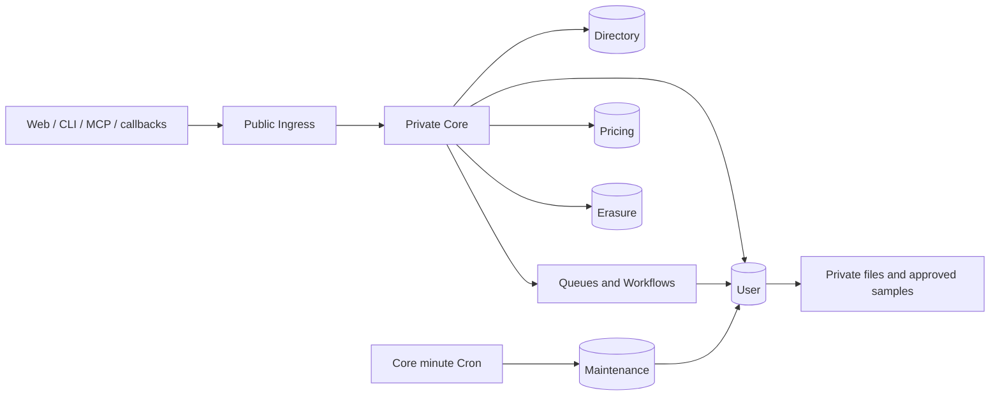

# Architecture

Fidy is one domain model served through web, CLI, MCP and a hosted agent. This document describes
system ownership, runtime topology and cross-application boundaries.

Architecture documents cover responsibilities, dependencies, trust boundaries and durable design
choices. Keep feature behavior in owner-local `FEATURE.md` files, design rationale in ADRs,
procedures in guides and runbooks, and implementation evidence with the relevant issue or PR.

## System ownership

| Application                                       | Responsibility                                                                    |
| ------------------------------------------------- | --------------------------------------------------------------------------------- |
| [Server](apps/server/ARCHITECTURE.md)             | Domain model, canonical operations, provider integration and Cloudflare execution |
| [Web](apps/web/ARCHITECTURE.md)                   | Product UI and browser interactions                                               |
| [CLI](apps/cli/ARCHITECTURE.md)                   | Terminal client and local credential custody                                      |
| [Docs](apps/docs/ARCHITECTURE.md)                 | Public customer and User-owned-agent guides and API reference                     |
| [Site](apps/site/ARCHITECTURE.md)                 | Public marketing, legal documents and discovery                                   |
| [Infrastructure](infra/cloudflare/alchemy.run.ts) | Deployment topology, resource wiring and edge policy                              |

The workspace owns shared dependencies, tooling and CI.

## Production boundary

Public Ingress routes browser, CLI, MCP and provider requests to private Core. Core resolves pre-User proofs and routing keys through Directory. Each registered User has one SQLite Durable Object for financial facts, live authority, accountable reads and atomic mutations. Pricing publishes shared terms, Maintenance records bounded owner discovery, and Erasure holds independent custody evidence. Web, marketing and customer documentation have separate Workers.

User alarms resume retained intent, recover missed queue handoffs and reconcile provider outcomes. R2 holds bytes separately from SQLite. The private forwarded Email Worker keeps external mail admission closed until sender verification and Connection admission are configured. The addressed User processes and expires eligible private Email. Local development uses the application Worker entrypoints and native SQLite bindings. [Storage ownership decision](docs/adr/0041-per-user-durable-object-storage-direction.md)

## Cross-application contract

The server declares canonical operations once. HTTP clients, MCP and hosted tools derive from those
declarations and share owner behavior and authorization. Web and CLI consume browser-safe contracts
and published transport resources. Dedicated authentication, payment, privacy and delivery transports
retain their own authority boundaries. Browser sessions, PATs and OAuth agent grants
remain distinct credentials.

Owners publish declarations, behavior and runtime construction through narrow interfaces. Domain
code stays independent of native adapters, and consumers cannot depend on another owner's private
implementation. See [owner publication](docs/adr/0031-published-owner-interfaces-and-visible-internals.md)
and [contract generation](docs/server-contract-artifacts.md).

## State and delivery

User-scoped database units commit owner changes, live authority checks and accountability together.
External calls and object storage require retained intent and reconciliation across that boundary.
Acceptance of work is distinct from completed delivery or verified provider settlement.

## Further reading

- [Glossary](GLOSSARY.md): domain vocabulary.
- [Coding standards](CODING_STANDARDS.md) and [security standards](SECURITY_STANDARDS.md): shared invariants.
- [ADRs](docs/adr/): design decisions and tradeoffs.
- [Production runbook](docs/operations/production-releases.md): release and rollback procedures.
