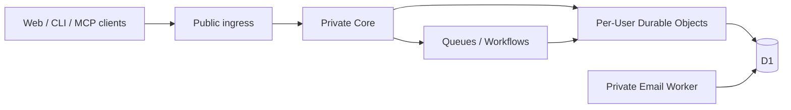

# Architecture

Fidy is one domain model served through web, CLI, MCP and a hosted agent. This document describes
system ownership, runtime topology and cross-application boundaries. Feature specifications, schema
fields and operational procedures live in their linked references.

## System ownership

| Package                                                      | Responsibility                                                                                       |
| ------------------------------------------------------------ | ---------------------------------------------------------------------------------------------------- |
| [Server](apps/server/ARCHITECTURE.md)                        | Domain model, canonical operations, provider contracts and Cloudflare application adapters           |
| [Web](apps/web/ARCHITECTURE.md)                              | React product application and browser interactions                                                   |
| [CLI](apps/cli/ARCHITECTURE.md)                              | Bun executable, server-derived client and native credential storage                                  |
| [Docs](apps/docs/ARCHITECTURE.md)                            | Public customer and User-owned-agent guides, generated reference snapshots and automatic publication |
| [Site](apps/site/ARCHITECTURE.md)                            | Public marketing, legal documents and discovery                                                      |
| [Cloudflare infrastructure](infra/cloudflare/alchemy.run.ts) | Deployment topology, resource wiring and edge policy                                                 |
| Workspace                                                    | Dependencies, shared tooling and CI                                                                  |

## Production boundary

Cloudflare is the sole Production runtime. The public ingress Worker forwards to a private Core
Worker and has no D1 binding. Core owns the User-scoped data API; the unrouted Email Worker has
narrow forwarded-mail admission and retention authority. Static site and web Workers serve the
marketing and product applications separately. The customer docs use an independent assets-only
stack, automatically published when documentation or its build inputs change on trunk.

D1 retains application state; Durable Objects coordinate per-User work; Queues redeliver bounded
identities; Workflows execute durable steps; R2 retains private bytes; Workers AI supplies
Fidy-controlled inference. An independent private erasure registry protects deletion across D1
restoration. Local development uses the same Worker entrypoints and binding graph.
See [ADR 0026](docs/adr/0026-cloudflare-native-production-replatform.md).

## Cross-application contract

The server declares canonical operations once. HTTP, typed clients, MCP and the hosted agent derive
from those declarations and share authorization and owner behavior. Web and CLI consume browser-safe
server contracts; server implementations stay private. OpenAPI and operation-policy artifacts are
generated evidence. See [contract generation](docs/server-contract-artifacts.md).

Credential bootstrap, statement-byte staging, hosted conversation/delivery, payment enrollment and
privacy controls have dedicated transports with their own proof boundaries. They do not gain
canonical or agent authority merely by being reachable. OAuth agent grants, browser sessions and
PATs remain separate credentials; the hosted agent uses the same canonical tools as external agents.

## Owner publication

Owners publish only the interfaces they earn: `contract.ts` for declarations, `operations.ts` for
behavior and `runtime.ts` for construction. Private implementation stays with its owner. These
boundaries apply to application code, tests, tooling and infrastructure. Portable domain code
remains independent of native adapters. See
[ADR 0031](docs/adr/0031-published-owner-interfaces-and-visible-internals.md).

### Public-surface review

Review changed publications for leaked private functions, types and storage/provider shapes,
including indirect exports. Dependency checks complement this semantic review; the detailed
[review criteria](docs/adr/0031-published-owner-interfaces-and-visible-internals.md#public-surface-review)
live with the publication decision.

## State and delivery

User-scoped D1 units commit owner changes, live authority checks and accountability together.
Durable Object serialization complements database guards. External calls and object storage cannot
participate in that database commit: retained intent, bounded dispatch and verified outcomes bridge
those boundaries. A successful handoff is distinct from completed delivery or provider settlement.

## Deployment and evolution

GitHub Actions deploys an exact trunk revision, applies migrations and verifies staged Worker
versions before promotion. Code rollback changes traffic, not database or external state. The
[Production runbook](docs/operations/production-releases.md) owns the release procedure.

Domain terms belong in [GLOSSARY.md](GLOSSARY.md), coding and storage conventions in
[CODING_STANDARDS.md](CODING_STANDARDS.md), security invariants in
[SECURITY_STANDARDS.md](SECURITY_STANDARDS.md), and durable design rationale in [ADRs](docs/adr/).
