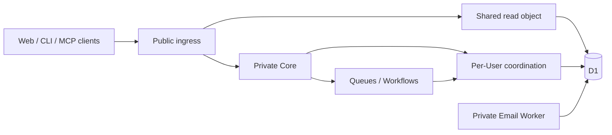

# Architecture

Fidy is one domain model served through web, CLI, MCP and a hosted agent. This document describes
system ownership, runtime topology and cross-application boundaries.

Architecture documents cover responsibilities, dependencies, trust boundaries and durable design
choices. Keep feature behavior in owner-local `FEATURE.md` files, design rationale in ADRs,
procedures in guides and runbooks, and implementation evidence with the relevant issue or PR.

## System ownership

| Application                                       | Responsibility                                                                    |
| ------------------------------------------------- | --------------------------------------------------------------------------------- |
| [Server](apps/server/ARCHITECTURE.md)             | Domain model, canonical operations, provider integration and Cloudflare execution |
| [Web](apps/web/ARCHITECTURE.md)                   | Product UI and browser interactions                                               |
| [CLI](apps/cli/ARCHITECTURE.md)                   | Terminal client and local credential custody                                      |
| [Docs](apps/docs/ARCHITECTURE.md)                 | Public customer and User-owned-agent guides and API reference                     |
| [Site](apps/site/ARCHITECTURE.md)                 | Public marketing, legal documents and discovery                                   |
| [Infrastructure](infra/cloudflare/alchemy.run.ts) | Deployment topology, resource wiring and edge policy                              |

The workspace owns shared dependencies, tooling and CI.

## Production boundary

Cloudflare is the sole Production runtime. Public ingress has no database binding and forwards
API traffic to private server execution. Core owns the User-scoped API and coordinates mutations
through per-User Durable Objects. When enabled, a shared read object serves existing query
transports. The private Email Worker has a separate, narrow admission and retention boundary.
Web, marketing and customer documentation are served by separate Workers.

D1 holds application state; Durable Objects coordinate work; Queues and Workflows drive durable
background execution; R2 holds private files. An independent erasure registry protects deletion
across database restoration. External providers supply inference, messaging, authentication and
payments through server-owned adapters. Local development uses the same Worker entrypoints and
binding graph. See [the runtime decision](docs/adr/0026-cloudflare-native-production-replatform.md).

## Cross-application contract

The server declares canonical operations once. HTTP clients, MCP and hosted tools derive from those
declarations and share owner behavior and authorization. Web and CLI consume browser-safe contracts
and published transport resources. Dedicated authentication, payment, privacy and delivery transports
retain their own authority boundaries. Browser sessions, PATs and OAuth agent grants
remain distinct credentials.

Owners publish declarations, behavior and runtime construction through narrow interfaces. Domain
code stays independent of native adapters, and consumers cannot depend on another owner's private
implementation. See [owner publication](docs/adr/0031-published-owner-interfaces-and-visible-internals.md)
and [contract generation](docs/server-contract-artifacts.md).

## State and delivery

User-scoped database units commit owner changes, live authority checks and accountability together.
External calls and object storage require retained intent and reconciliation across that boundary.
Acceptance of work is distinct from completed delivery or verified provider settlement.

## Further reading

- [Glossary](GLOSSARY.md): domain vocabulary.
- [Coding standards](CODING_STANDARDS.md) and [security standards](SECURITY_STANDARDS.md): shared invariants.
- [ADRs](docs/adr/): design decisions and tradeoffs.
- [Production runbook](docs/operations/production-releases.md): release and rollback procedures.
