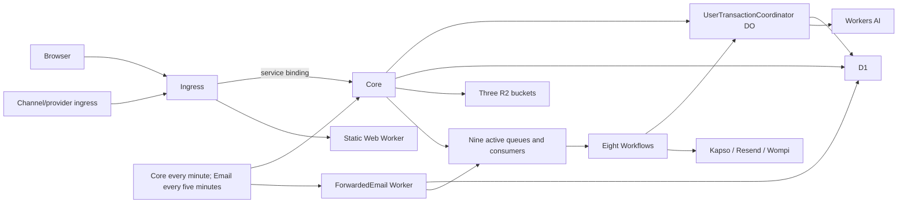

# Infrastructure performance and capacity assessment — 2026-10-11

## Verdict and evidence status

This reconciles the earlier optimization reports with expanded workload measurements. Source base:
`8ce7fd176d98968250b080c8b8f06e5ef24d37f7`. The companion
[measurements](infra-capacity-measurements-2026-10-11.json) preserve cohorts, boundaries and collection
times. The [capacity model](infra-capacity-model-2026-10-11.json) distinguishes observed coefficients
from explicit workload and reserve assumptions. Historical documents remain dated evidence, not
current deployment status.

The current free allocation is constrained primarily by **AI neurons, D1 writes and installed
admission limits**, depending on workload. Indexed History reads remain bounded as history and
Reconciliation density grow. There is no evidence supporting a general caching or topology change.
Two further changes are supported: eliminate redundant idle PAT assertion writes, and terminate
permanent statement capture refusals without futile durable retries.

Retained production hosted Turn completion timings are measured below. Fresh controlled live Turn
growth testing is unavailable in the current window: an authorized minimal inference returned
HTTP 429 / error 4006, daily allocation exhausted. Production AI usage and native hosted execution
are measured separately. This report does **not** turn that
refusal, synthetic provider behavior, short bursts, or sparse production samples into a successful
live Turn capacity claim. Guaranteed peak heap, a statistically identified cold-start population,
and actual Kapso/Wompi/Resend product latency tails are also unavailable. These are explicit limits
of the assessment rather than zero cost or zero latency.

## Infrastructure and request flow

The application has four Workers, one D1 primary without read replication, one coordinator DO
namespace, three R2 buckets, ten queues including the dead-letter queue, and eight Workflow
definitions. Alchemy adds a state Worker and DO namespace, bringing the account inventory to five
Workers/two namespaces. Ingress-to-Core service bindings add no second billable external request.
The coordinator serializes a User's protected work; different Users have separate objects but share
D1 and account allocations. D1 batches preserve row/evidence atomicity; outboxes, stable Workflow
identities and replay checks preserve durable handoff. Core and Email schedule 1,728 firings/day.
The operational Queue canary runs every minute; its Workflow identity covers a **five-minute**
period, giving 1,440 messages and 288 successful Workflow steps/day, before failures or releases.

Sources: [repository topology](../../infra/cloudflare/alchemy.run.ts),
[server architecture](../../apps/server/ARCHITECTURE.md),
[service binding accounting](https://developers.cloudflare.com/workers/runtime-apis/bindings/service-bindings/).

## Reconciled optimization ledger

| Change                                                                    | Before → after                                                                                                                              | Regression/measurement boundary                                                                                          | Deployment evidence                                                     |
| ------------------------------------------------------------------------- | ------------------------------------------------------------------------------------------------------------------------------------------- | ------------------------------------------------------------------------------------------------------------------------ | ----------------------------------------------------------------------- |
| PR #1194: remove unused trigram FTS; atomic review capacity               | Capture reads 542 → 42; Correction 1,304 → 300; linked 20k History 430,002 → 304; 1,024 review reads 1,587,487 → 20,252                     | Full-migration native query/write and review cohorts; exact History, Correction, replay and global review-capacity tests | Merged and included in current release                                  |
| PR #1201: fonts and deferred route assets                                 | Body 890,043 → 638,558 bytes; matched mobile median LCP 3,216 → 2,440 ms                                                                    | Controlled original browser comparison; later frontend rewrite means current navigation is a separate cohort             | Merged; deployment subsequently restored; current site remeasured below |
| PR #1206: scoped budget work                                              | Status with 5,001 unrelated records 5,025 → 25 reads; capture 95,964 → 42,571; refusal 65,717 → 12,332; retry 107,272 → 45,296              | Real native owner and public admission fixtures, scope/isolation/rollback tests                                          | Merged and included in current release                                  |
| Migration 0086: retire obsolete resolved onboarding alert                 | Reproduced failed `async.health` → successful delivery path; 26 alert tests passed                                                          | Only already-resolved retired-owner record removed; current-owner/active alerts preserved                                | Schema and clean post-release window verified previously                |
| Hosted parser proof on actual coordinator DO                              | 24 cohorts: bounded successful parses, refusals and overlapping requests                                                                    | Existing Free DO runtime; no guaranteed peak CPU/heap telemetry from short-lived proof                                   | Hosted workflow run 38149419394 succeeded                               |
| Current candidate: avoid identical PAT expiry assertion updates           | Warm full Core tick 23 → 21 D1 writes; first tick 44 → 43                                                                                   | Full-schema maintenance and native PAT rollback tests; CHECK still refuses invalid transition                            | Candidate until release verification below                              |
| Current candidate: settle permanent capture admission refusal immediately | 101-row statement previously throws retryable unavailable → terminal resource-limit in activity 4, 100 committed captures/evidence retained | Full migration chain, actual installed trigger, cross-User isolation and late replay                                     | Candidate until release verification below                              |

Percent improvements apply only to their matched workload/boundary. Unlinked History changed from
102 to 304 reads to support the exact effective relation; review writes rose 8,304 → 9,328 for the
atomic counter. Those are retained correctness/cost tradeoffs. The web rewrite is not attributed to
this infrastructure work. PR/revision links and original cohorts are in the dated
[follow-up](infra-performance-followup-2026-10-11.md) and
[production assessment](infra-performance-production-2026-10-10.md).

## Expanded native baseline and growth

### Canonical requests and User contention

The declared catalog has 68 operations; earlier successful native fixtures cover 66. The declarations
`identity.updateUserPreferences` and `transactions.listSourceAttestations` lack an installed owner.
Their missing feature performance is unavailable, not a slow endpoint to optimize. Fresh observed
regression results are attached below and grouped by operation/status/boundary in the JSON. Observer labels distinguish **direct Core D1** from **held
canonical owner D1**; these are not interchangeable or safely summed as end-to-end request cost.
Host-process CPU excludes workerd and is never reported as Worker CPU. Adversarial fixtures protect
correctness; their aggregate percentiles are not a representative User traffic distribution.

Public mixed-load cohorts traverse actual public/Core adapters and native SQLite DO coordination.
Each request alternates indexed History and capture; each User has separate authority. Paced traffic
uses 1.05 seconds between that User's offered requests. One client/IP and empty initial histories
are controlled assumptions. Offered and accepted throughput are reported separately.

| Users | Paced offered/accepted | Accepted rps | Accepted p95 | Unpaced offered/accepted/refused | Unpaced accepted p95 |
| ----- | ---------------------- | ------------ | ------------ | -------------------------------- | -------------------- |
| 1     | 24 / 24                | 0.99         | 50.7 ms      | 128 / 8 / 120                    | 499.7 ms             |
| 8     | 192 / 192              | 7.65         | 41.0 ms      | 1,024 / 136 / 888                | 536.3 ms             |
| 32    | 768 / 768              | 30.47        | 25.9 ms      | 4,096 / 1,632 / 2,464            | 540.5 ms             |

Paced cohorts last about 25 seconds, not a production endurance run. Bursts can span renewed policy
windows; their accepted count is not a fixed per-User daily budget. Every accepted capture matches
its User's committed row count; no admission leases remain. High refusal throughput does not imply
high useful capacity. The 100,000 daily account request allocation alone cannot sustain 30 rps all
day: it corresponds to about 1.16 requests/s averaged over 24 hours, before other account work.

### History, Reconciliation density and foreign records

Twelve full-schema cohorts combine 200/2,000/20,000 subject records, equally large foreign histories,
and 0/25/50/100% linked density. Ten reads per cohort record native rows scanned and elapsed time.
The first 101 effective results require **304 reads**, except the fully linked 200-record case
returns all 100 effective results with 302 reads. Foreign volume and dense Reconciliation do not
introduce a full-history scan. Bulk fixture arrangement temporarily suppresses only projection
refresh; the complete trigger graph is restored before every measurement.

Absent substring searches are a different cost class: six cohorts at the same history sizes,
with zero/full linked density, repeat each query five times. At 20,000 source records an absent term
scans **20,003 reads unlinked / 10,003 fully linked**, returns zero records, and excludes foreign
history. This linear read cost is retained deliberately: restoring the retired write-heavy FTS
would reverse the measured capture/Correction savings. Under the default scenario, about 100 such
searches/day fit the 3-million-read planning budget; ordinary 304-read pages must not be used to
price these searches.

### Maintenance, backlog and foreground interference

All 41 configured Core activities and both Email activities execute against every migration.
Warm idle Core uses **289 reads / 21 writes** per minute; Email uses **4 reads / 0 writes** every five
minutes. 0/2,000/20,000 retained AI admissions have identical idle cost. A 4,096 expired-grant backlog
removes **128 grants per tick**; warm full ticks use 1,437 reads / 277 writes. With no new arrivals,
32 eligible ticks clear this cohort (about 32 minutes at the configured cadence). Cleanup consumes
1,152 reads / 256 writes per 128 grants, in addition to idle work.

Six alternating contention samples run 128 History pages at concurrency eight against a 20,000-row
linked history, with or without eight consecutive complete maintenance ticks. Foreground reads
remain 38,912 and writes zero. Backlog work removes 1,024 grants; measured maintenance writes fall
2,261 → 2,246 for these eight ticks after the assertion optimization. The latest median of three
per-run foreground p95 values is 39.2 ms without maintenance / 51.3 ms with it. This demonstrates
local interference, not a production slowdown percentage: three samples, cold initialization,
ambient host activity and a compressed cadence limit causal interpretation. Joined elapsed time
includes remaining background work and is not foreground throughput.

Avoid extending cleanup batches on that evidence. The existing bounded cadence preserves foreground
headroom. Removing two redundant assertion updates saves **2,880 D1 writes/day**, an 8.7% reduction
of the measured idle Core writes, while retaining health freshness and rollback guards. Actual idle
account cost also includes canary consumers/Workflows, heartbeat logging and release work.

### Complete statement ingestion

Source staging and entitlement arrangement precede measurement; full parsing/materialization,
classification, category work, row/evidence writes and finalization are measured. Each cohort has
three fresh samples. One R2 head/get reads the complete source once; there are no materialized-object
puts for these small CSV sources. Native elapsed times include sequential activity execution and
exclude real Workflow scheduling, staging upload and external-provider latency.

| Kind / source rows   | Terminal state / processed rows | D1 reads / writes | Activities | Median completion |
| -------------------- | ------------------------------- | ----------------- | ---------- | ----------------- |
| Captures / 96        | completed / 96                  | 50,814 / 8,636    | 3          | 829 ms            |
| Captures / 1,024     | resource-limit / 100            | 54,640 / 9,096    | 4          | 939 ms            |
| Captures / 4,096     | resource-limit / 100            | 55,528 / 9,384    | 4          | 1,054 ms          |
| Needs Review / 96    | completed / 96                  | 1,918 / 889       | 3          | 562 ms            |
| Needs Review / 1,024 | completed / 1,024               | 20,252 / 9,328    | 32         | 5,595 ms          |
| Needs Review / 4,096 | completed / 4,096               | 80,948 / 37,264   | 128        | 22,705 ms         |

The installed `transaction_manual_daily_budget` trigger counts **every Transaction insert**,
including statements: 100 Transactions/User/UTC day. Its name does not make statements exempt.
The successful 96-row sample did not expose this limit; 101 rows do. The new terminal failure
classification preserves that installed admission policy and all 100 committed rows, outcomes,
SourceAttestations and consumed entitlement. Unknown/transient D1 failures remain retryable. Global
pending review capacity is independently 5,000 records; two unresolved 4,096-row review statements
cannot both finish. The complete capture cost is substantially higher than the 42-read/44-write
isolated capture owner coefficient; these different boundaries must not be substituted.

### Asynchronous delivery and recovery

Native Queue cohorts use the real Core consumer, a real broker and a synthetic Workflow handoff.
One identity is unavailable until recovery; Miniflare retries the whole failed ten-message batch,
including explicitly acknowledged neighbors. Production's individual ack behavior is a separate
boundary. Successful handoffs retain unique identities and all originally offered work recovers.

| Backlog | Observed deliveries / dead letters | Recovery completion | Offer-to-handoff p50 / p95 / p99 |
| ------- | ---------------------------------- | ------------------- | -------------------------------- |
| 10      | 50 / 10                            | 162 ms              | 17 / 148 / 148 ms                |
| 100     | 230 / 10                           | 334 ms              | 60 / 98 / 100 ms                 |
| 1,000   | 2,030 / 10                         | 1,876 ms            | 469 / 777 / 803 ms               |

Each row is one cohort. The timing includes broker, durable owner eligibility and synthetic Workflow
creation; it does not isolate queue wait or measure real downstream completion. Three operations per
successful small Queue message is the normal daily model; retries and DLQ delivery add cost. Native
proof deliberately includes a full replay, so its delivery amplification is not steady-state cost.

Production 18:00–18:51 UTC analytics provide actual mean message age: canary reads **4,032 ms**
(51 samples), successful deletes **4,109 ms** (50), average retries zero. Release-proof reads average
3,045 ms (12), successful deletes 3,086 ms (12). A message crossing the window explains unequal
canary read/delete counts; it is not proof of loss. Eleven canary and twelve release Workflows
succeed with zero retries. Available Workflow queue-wait samples are about 1.80–1.84 seconds; this
is scheduler wait, not total product completion. Product queues have no representative production
latency cohort. Existing native provider delivery/replay/failure tests cover correctness separately.
No production DLQ replay or deletion was performed; the historical 114-message DLQ remains preserved.

### Current browser and production resource observations

The current Foldkit release was navigated in three fresh desktop and three fresh mobile Chromium
contexts. Mobile: 1.6 Mbps down, 750 Kbps up, 150 ms latency, fourfold CPU throttling. All responses
were 200 with no page errors. Median LCP: **672 ms desktop / 2,580 ms mobile**; median CLS:
0.0018 / 0.0433. These are public navigation lab samples at one client location, not authenticated
browser traffic or field Web Vitals. Prior native/browser acceptance journeys separately validate
protected navigation and canonical operations.

The UTC-day account snapshot was collected at **18:29:51 UTC**; its requested end was 19:00, so it
must not be treated as a completed 19-hour window. D1: 566,345 reads / 44,289 writes; query-batch
p50/p95/p99 0.25/0.93/1.66 ms in ENAM. Primary size 6,500,352 bytes (about 1.3% of its 500 MB Free
limit). Coordinator DO sampled maximum memory 22,179,144 bytes; no CPU-limit, memory-limit or fatal
internal errors; 2,655.54 GB-s so far, about 20.4% of 13,000 GB-s/day. These are sampled observations,
not guaranteed peak bounds. Deployment state-store work is reported separately in the JSON.

AI has 71 reported successful calls plus 29 quota-refused calls. Successful reported neurons total
6,140.49, while a fresh request is already refused at the 10,000-neuron daily limit. Sampling,
attribution or reporting lag means the dashboard total cannot authorize further inference. Successful
call cohorts report aggregate provider inference time, not end-to-end hosted Turn time. No raw
prompts, User data, credentials or provider response bodies are retained in this report.

Retained production hosted Turns provide an anonymous completion baseline collected at 19:04 UTC:

| UTC day | Status | Count | Median | p95 / p99 | Maximum |
| ------- | ------ | ----- | ------ | --------- | ------- |
| Oct 10 | completed | 16 | 5,608 ms | 45,016 ms | 45,016 ms |
| Oct 10 | failed | 4 | 3,547 ms | 3,663 ms | 3,663 ms |
| Oct 10 | interrupted | 1 | 121,513 ms | 121,513 ms | 121,513 ms |
| Oct 11 | completed | 2 | 8,141 ms | 13,205 ms | 13,205 ms |
| Oct 11 | failed | 6 | 2,967 ms | 6,591 ms | 6,591 ms |

These are start-to-terminal times, using nearest-rank percentiles. The small retained population can
include development/CI traffic and spans deployments; it has no caller or release attribution.
Failures cannot all be attributed to AI quota from these status aggregates. No retained production
statement submissions were present in the same read-only query. These observations establish a
sparse production baseline, not successful controlled growth or a production latency SLO.

## Capacity, cost and operating budgets

Run `python3 scripts/infra-performance/capacity.py`, or supply a JSON scenario overriding the defaults.
It reads measured statement coefficients from the companion artifact. Defaults are a planning
scenario: 1,000 owner History pages and 30 absent searches over 20,000 records/day, two 96-capture statements, one 1,024-review statement,
200 product Queue messages, 200 other Workflow steps, and seven hosted Turns. Each Turn assumes
four inferences with 20,000 input / 250 output tokens. All workload quantities and reserves are
assumptions, not a prediction of adoption. The AI formula uses the approved model's published
9,091 input / 27,273 output neurons per million tokens.

| Resource         | Scenario demand/day | Free allocation/day | Recommended planning budget/day |
| ---------------- | ------------------- | ------------------- | ------------------------------- |
| D1 reads         | 1,463,282           | 5,000,000           | 3,000,000                       |
| D1 writes        | 64,840              | 100,000             | 70,000                          |
| Queue operations | 5,920               | 10,000              | 7,000                           |
| Workflow steps   | 526                 | 3,000               | 2,100                           |
| AI neurons       | 7,281.87            | 10,000              | 8,000                           |

Idle schedules contribute 416,160 Core reads, 1,152 Email reads, and 30,240 Core writes/day. Explicit
reserves add 20,000 reads / 8,000 writes for unmodeled transport admission, canary delivery,
operational events and releases, 1,000 Queue operations for retries/releases and 2,000 AI neurons
for validation/other account consumers. Reserves are adjustable conservative assumptions; they are
not a measured total. Unmodeled activity exceeding them invalidates the scenario. R2/source staging,
DO invocation/active duration, Worker CPU and provider fees need their own account observations;
the calculator does not manufacture their coefficients from local latency.

Under this scenario AI has the highest allocation utilization (72.8%); capture/review-heavy demand
can make D1 writes or the installed 5,000-review/100-Transaction limits bind first. After measured
Core idle alone, 69,760 D1 writes remain before other work: at most one unresolved 4,096-review
statement fits global pending review capacity, and a second such full processing workload would
exceed the daily write budget if prior reviews were immediately settled and all other costs were
ignored. Under the default 70,000-write planning budget, the scenario leaves 5,160 writes.

The conservative seven-Turn budget is conditional on four 20k/250-token inferences, not an installed
User entitlement or measured Turn maximum. Smaller/fewer calls permit more Turns; tool continuations
and retries reduce capacity. Stop relying on reported neuron headroom when the live provider refuses.
The Free reset is **00:00 UTC**, which is 19:00 Bogotá. No Workers Paid plan is needed merely to run
the proven bounded parser on its actual existing DO runtime. A paid HTTP Worker CPU configuration
rejected by the earlier standalone harness was a harness/runtime mismatch, not an optimization
requirement.

Use account-level warning budgets of 50,000 dynamic Worker requests/day, 9,100 DO GB-s/day,
350 MB in the primary D1 and 7 GB R2 Standard storage. These retain headroom; they are recommendations,
not enforced configuration or proven peak concurrency. Native 32-User results establish a short
local tested envelope only. The fixed canary consumes 43.2% of Free Queue operations/day; keep
product messages below roughly 560/day within a 7,000-operation planning budget with the 1,000-op
reserve. Maintain the current canary freshness until a separately justified product decision changes it.

Free D1/Queues/AI allocation exhaustion is a service refusal risk, not an automatically payable
bill. R2 subscription discovery returned Paid; usage within Standard included allocations does not
imply the entire account's invoice is zero. Provider fees and other workloads are not observable in
Cloudflare analytics. No billing upgrade or subscription change was performed.

Sources: [D1 pricing](https://developers.cloudflare.com/d1/platform/pricing/),
[D1 limits](https://developers.cloudflare.com/d1/platform/limits/),
[Workers limits](https://developers.cloudflare.com/workers/platform/limits/),
[DO pricing](https://developers.cloudflare.com/durable-objects/platform/pricing/),
[Queues pricing](https://developers.cloudflare.com/queues/platform/pricing/),
[Workflows pricing](https://developers.cloudflare.com/workflows/reference/pricing/),
[AI pricing](https://developers.cloudflare.com/workers-ai/platform/pricing/),
[R2 pricing](https://developers.cloudflare.com/r2/pricing/).

## Reproduction and validation

- `INFRA_PERFORMANCE_GROWTH=1 bun run --cwd apps/server test:cloudflare cloudflare/transactions/transactions.test.ts -t 'measures sustained' --maxWorkers=1`
- `INFRA_PERFORMANCE_MEASURE=1 bun run --cwd apps/server test:cloudflare cloudflare/transactions/query-costs.test.ts cloudflare/transactions/performance.test.ts cloudflare/maintenance/performance.test.ts cloudflare/ingestion/statement-processing.test.ts cloudflare/queue/native-recovery.test.ts --maxWorkers=1`
- `bun run --cwd apps/server test:cloudflare cloudflare/tokens/pats.test.ts cloudflare/tokens/retention.test.ts --maxWorkers=1`
- From `apps/server`: `bun --bun ../../node_modules/vitest/vitest.mjs run --config ../../scripts/infra-performance/vitest.config.ts` records labeled canonical fixture measurements.
- `python3 scripts/infra-performance/capacity.py` reproduces the daily scenario and remaining budgets.

Focused full-schema statement/maintenance/PAT validation: **112 tests passed**. Queue recovery:
**one test passed across all three growth cohorts**. The 101-row regression was observed red before
the fix and green afterward. Static/type-aware lint, server typecheck and dependency graph pass. Full native regression: **134 files / 1,778 tests passed**, 2 files / 17 tests skipped, 508.46 seconds. Fresh canonical observations are summarized separately; candidate measurements alone do not establish deployed behavior. Deployment validation is recorded below after release.
